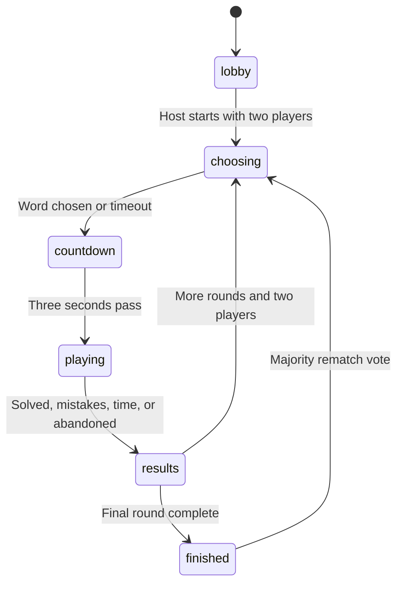

# HÄNGD architecture

## Boundaries

One authoritative room state lives in D1. Clients submit intent: a letter, complete guess, card or vote. The server checks permission and time, applies the action, persists it and returns a deliberately filtered view.

React never decides that a guess is correct or adds points. It animates responses, renders a clock and disables controls during cooldowns. Changing client code or the displayed clock cannot override server validation.

| Layer | File | Owns |
| --- | --- | --- |
| UI | `components/game.tsx` | Forms, screens, keyboard and score display |
| Client transport | `lib/use-room.ts` | Credential, commands, SSE renewal, fallback and clock offset |
| Wire contract | `lib/protocol.ts` | `GameAction`, `PublicRoom` and settings types |
| Request layer | `lib/server.ts` | Parsing, bearer authentication, rate limits, D1 operations and serialization |
| Rules | `lib/engine.ts` | Validation, phases, presence, scoring, cards and cooldowns |
| Persistence | `db/schema.ts`, `drizzle/` | Room/version/expiry and rate-limit tables |

## State machine

The host sets 2–20 total word rounds, not a guaranteed number of turns per participant. `beginRound` chooses a connected player with the fewest Word Master turns so roles rotate while players arrive or leave.

Selection lasts 45 seconds, countdown three seconds and results 12 seconds. If results end without two connected players, progression waits and resumes when enough players reconnect. A master who supplies no word receives a suggested fallback. If no connected guessers remain in an active room, the round can finish as abandoned.

All deadlines are absolute server timestamps. `advance(room, now)` runs on reads and commands. No browser-owned timer or in-memory-only scheduler is required for correctness. If nobody is connected, stored state can remain in an old phase until the next request evaluates the deadlines. Choosing/results intervals begin from the transition actually processed rather than retroactively running an unattended whole match.

## Atomic updates

| `rooms` column | Meaning |
| --- | --- |
| `code` | Six-character primary key |
| `state` | Serialized internal room, including private state |
| `version` | Monotonically increasing concurrency version |
| `expires_at` | Last permitted access time |

Each command:

1. Reads the room through a D1 session using `first-primary`.
2. Finds the player matching the presented credential's stored hash.
3. Refreshes presence, evaluates deadlines and validates the action.
4. Applies the action to this request's copy of the room.
5. Writes using `UPDATE ... WHERE code = ? AND version = ?`, incrementing the version.
6. Rereads and reevaluates if another request won the race. Nine failed attempts produce a conflict error.

This compare-and-swap prevents simultaneous correct-letter actions from both scoring and stale requests from overwriting newer scores. The engine has no external side effects, so retrying a losing attempt is safe. An action that became invalid, such as a repeated letter, is rejected against the winning state.

Timers and social events use the same persisted model. Success is returned only after the write succeeds. Expiry is enforced on access even before cleanup physically removes a row.

## Real-time transport

Actions are authenticated JSON POST requests. Each client also opens an authenticated `fetch` stream carrying Server-Sent Events. Fetch permits a bearer header; the credential never needs to appear in the invite URL.

The server emits an initial personalized snapshot, checks D1 approximately every 450 ms and emits another snapshot when the room version changes. Unchanged state produces occasional clock messages. Heartbeats refresh periodically during active streams. Connections renew after a bounded number of checks to limit their lifetime and database work.

The client applies snapshots monotonically by version, checks the active session before accepting old stream data, computes a display offset from `serverNow`, aborts idle streams after eight seconds and reconnects with backoff. Repeated stream failures enable HTTP snapshot polling before another SSE attempt. Session changes abort obsolete streams. Leaving is locally immediate; a best-effort notification and presence expiry handle an unreachable server.

The 450 ms interval is a polling cadence, not a latency guarantee. Delay also includes D1, scheduling and network latency. Each active player generates database reads. Large public scale needs measurement and could justify a per-room Durable Object/WebSocket fan-out architecture; this version does not claim that optimization or load-test coverage.

## API

Room responses use non-cacheable headers. Mutations require JSON, a small body limit and a matching browser origin.

| Method and path | Credential | Result |
| --- | --- | --- |
| `POST /api/rooms` | None | Create; return `room`, raw `token`, `playerId` |
| `POST /api/rooms/:code/join` | None | Join as new player; return `room`, `token`, `playerId` |
| `GET /api/rooms/:code` | Bearer | Personalized snapshot and heartbeat |
| `GET /api/rooms/:code/events` | Bearer | Renewable SSE stream |
| `POST /api/rooms/:code/actions` | Bearer | Apply action; return room or leave acknowledgement |
| `GET /api/health` | None | Check database binding and room-table access |

Errors return an HTTP status and `{ "error": "message", "code": "code" }`. Internal exceptions are not exposed. SSE uses `room` events with `PublicRoom`, `clock` events with `{ serverNow }`, and `error` events with `{ error, code }`.

Accepted actions are `settings`, `start`, `word`, `letter`, `solve`, `sabotage`, `bluffVote`, `doubleAccept`, `chat`, `typing`, `reaction`, `next`, `rematch`, `leave` and `heartbeat`. The server does not accept client-supplied scores, correct-answer flags or deadlines as authoritative data.

## Credentials and word privacy

Creating/joining issues 32 cryptographically random bytes as 64 hex characters. The internal player record persists only their SHA-256 digest. The raw token is returned once and saved with the room code under `hangd:session:v1` in `sessionStorage`.

It survives same-tab refresh but is not an account. A nickname cannot recover it, and another device creates a new participant. Anyone possessing the raw bearer token can act as that player; it must not enter logs, chat, invite links or public snapshots.

`publicRoom` builds a fresh object from an explicit allowlist and never serializes the internal room directly. Before results:

- Guessers receive only masked letters, the public clue and public gameplay state.
- The master receives the secret and, during selection, suggestions.
- Other players' full-word submissions and wrong full-word guesses remain private.
- Bluff truth remains private to the master; voters see only their own vote.
- Nobody receives token hashes.

At results, the answer and up to five recent wrong complete guesses are intentionally revealed. The guesses are shown as supplied; no algorithm ranks their humor.

The engine and word suggestions are server dependencies. Client code imports the shared protocol, not the engine. A guesser's response does not contain the answer for browser inspection. This cannot stop a master from telling a friend the answer elsewhere.

## Presence and recovery

A player is connected when they have not left and their last heartbeat is no more than 20 seconds old. Commands and authenticated reads refresh presence. The host transfers to another connected player when the current host leaves or disconnects.

Disconnected players retain scores and credentials in the room. Late joiners spectate until the next round. A master disconnecting does not freeze a selected puzzle. Empty/inactive room data eventually expires.

Active writes extend expiry by 12 hours. If an update sees nobody active in the previous five minutes, it uses a 30-minute window. Cleanup is probabilistic and bounded per request, so physical deletion may occur after access has expired. This is temporary room retention, not a permanent match history service.

## Abuse and balance controls

Persisted, hashed-IP fixed-window budgets cover creation, joining, actions, stream openings and snapshots. Per-player limits separately allow one letter per 650 ms, one full-word guess per four seconds, one chat message per 1.2 seconds and one reaction per 1.5 seconds. Typing updates are limited to roughly once per second. Shared-IP budgets accommodate friends on one network; they are not a full distributed abuse-prevention system.

Word validation enforces alphabet, length, at least three letters, basic vowel/variety checks, no answer repetition within a match and a small abusive-language denylist. Clues cannot contain a direct normalized copy of the answer. Master/solver chat is disabled during active phases and other active chat cannot directly contain the answer.

These guardrails cannot validate a complete language dictionary, semantic clue quality, every offensive expression or indirect answer encoding. Suggestions and solve-dependent master rewards discourage impossible words without claiming automated language adjudication.

Cards are limited server-side to three per round, one of each type and an eight-second cooldown. PANIK changes only a temporary displayed deadline. DIMMA hides a position while preserving the known-letter record. The double challenge is opt-in; its penalty settles once when its deadline or the round ends. Bluff votes settle once at results using the master's declared truth value.

## Sound and animation

The original inline SVG mascot uses CSS animation and a foam-glove machine rather than graphic hanging. Reduced-motion preferences disable animations.

`lib/audio.ts` creates Web Audio nodes only after interaction. Original sixteen-bar music has scene-specific arrangements. Music and effects share mute/volume controls and a soft compressor. Scheduling pauses in hidden pages; the singleton supports explicit cleanup. Audio initialization failure does not prevent play.

## Build and deployment

The source uses Next.js App Router conventions and React; Vinext produces the Worker and browser assets. `dist/server/index.js` is the entrypoint and `dist/client` the static asset directory. The Worker requires a D1 binding named `DB`.

The build generates a local Wrangler config with an emulation database ID. Sites provisions hosted bindings during publication. Direct Cloudflare deployment needs a real ID; the README supplies a separate persistent `wrangler.deploy.json` configuration.

Local Miniflare/D1 storage lives in `.wrangler/state`, separately from hosted D1. Committed SQL migrations define the schema. Do not rewrite an applied migration; generate a new migration for schema changes.

## Verification scope

`pnpm check` checks TypeScript; `pnpm test` runs engine assertions without a server; `pnpm test:integration` uses independent clients against `HANGD_TEST_URL`. These tools support checks of secrecy, concurrent actions, progression, recovery and complete matches.

Report actual run output. Passing local integration tests does not prove that a physical phone, a public deployment or players on different networks were tested. Responsive browser checks also do not replace testing a phone's keyboard, audio restrictions and mobile network transitions.
