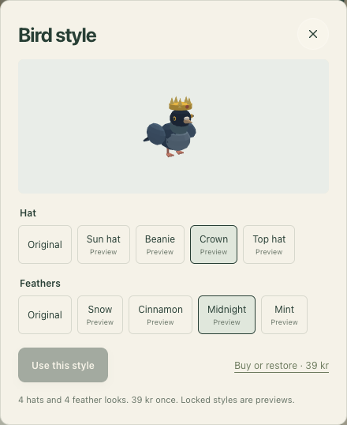
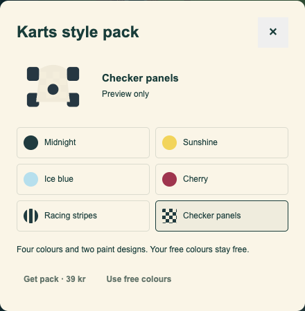

# Purchase release review

Updated 31 October 2026, Stockholm. **The bundle's test purchase, receipt, licence and local game
unlocks work. Paid production is not live.** The free public site is unchanged.

## Current hosted proof, 31 October

- Correct Games Free login is confirmed, including positive email verification and a complete empty
  subscription page. No further Cloudflare token or owner verification step is needed.
- The test commerce Worker and its test signing key are deployed on the approved Free account.
  The real bundle key resolves all three entitlements through the hosted service. Its signed proof
  verifies against the pinned public key and rejects a wrong challenge or live environment.
- Actual Worker testing found `redirect: 'error'` is unsupported by Cloudflare. Manual mode now
  rejects every redirect without forwarding the licence. Fresh sensitive review accepted the fix;
  15 focused resolver/actual-SQLite-DO checks and the real hosted licence/grant journey passed.
  Reference: [Cloudflare Request redirect modes](https://developers.cloudflare.com/workers/runtime-apis/request/).
- Ritkaos is restored at `https://ritkaos.ludvighedin.workers.dev`, with test restoration enabled and
  checkout deliberately hidden. The fixed deployment is `f7f6445d-81e4-4bdf-bb28-8736b03c8dc3`.
  The actual hosted 3-player WebSocket match, drawing, reconnect and scoring test passed. The public
  hub link is corrected in local source only; no static site or Mac release was published.
- The Mac package has been rebuilt with that shared resolver fix. All eight final packaged-app
  restore/restart journeys passed (`run-5l7rGn`), including bundle/update signature checks. All nine
  two-runtime purchase/isolation checks passed (`federation-TzNn3q`): the real hosted proof restores
  paid access across room hosts, wrong-connection replay fails, and reusable keys/auth headers never
  cross the room-host wire. These are two runtimes on one Mac, not two physical Macs. Private data
  was removed after verified process cleanup.
- The actual hosted Ritkaos native purchase test also passed: real key restores all ten rows, a free
  guest shares the paid host's Office/Blind settings, and an invalid key is refused.
- Live preparation is also deployed, **closed**: `ludvig-games-store` uses a distinct live signing
  pair, empty live products and rate namespace 4202. Fresh public checks confirm `ready: false`,
  `grantReady: false`, no checkout links and `store-unavailable` for validation. No activation
  operation exists in this preparation helper. No public shop or production Mac package was published.
- Lemon Squeezy now redirects the agent to login. Root requested only an existing Dia login in test
  mode for the remaining disabled-key operation. Cloudflare access is not the blocker.
- Ludvig completed that Dia login and enabled Test mode. Fresh isolated reads identified the actual
  remaining sign-in block: the guarded connection refuses the provider's `auth.lemonsqueezy.com/check`
  SSO request from its official redirect-challenge iframe. Refreshing app/auth cookies alone does not
  solve it. A separately enabled, exact-licence read-auth gate received fresh sensitive review and
  five focused policy checks passed. The actual official iframe request now passes the gate, bound
  to its current server-provided fields and signed frame. The provider nevertheless returns its own
  auth-login destination, so merchant access itself remains unavailable. No actual licence was changed.
  Ludvig then disabled only test licence 1726555 in his working session; his screenshot shows Disabled.
  The actual hosted negative probe passed: resolve and grant both return 422 `invalid-license`, with
  neither entitlements nor signed proof. Hosted Ritkaos refuses redemption and explicitly returns empty
  ownership. The test socket closed and the check process exited. This proves rejection at validation,
  not instant removal from an already open app or execution of a monetary refund. Next: Ludvig enables
  that same test licence; root reruns the existing hosted positive restoration checks. No regeneration,
  repeated generic sign-in request or Cloudflare token is needed.
- The four actual hosted test carts show **59/39/39/99 SEK**, their matching Pay labels, Sweden selected
  and `tax_inclusive: true`. No card fields or payment submission were used. Their captured cart tax
  remains zero, and no automatic tax request was observed in that final check. This is displayed-price
  evidence, not proof of Swedish live VAT or the earlier receipt's currency-conversion rounding.
- The provider has not replied to the already sent withdrawal-function question. Root owns the
  remaining delivery, refund/recovery, checkout/policy and conditional publication work.

## What is verified

- Four hidden test products exist in approved store 504842: Ritkaos+ 59 SEK, Pigeon style pack 39 SEK,
  Karts style pack 39 SEK and the three-pack bundle 99 SEK. Single payments, native perpetual keys.
- Ludvig completed the bundle purchase in provider test mode. Receipt order 5048421 arrived in the
  owner's inbox, explicitly marked Test Mode, and contains the native licence key.
- The private key validates against the actual provider and exact test bundle product/variant. It has
  no expiry. The service returns all three game entitlements and rejects a wrong-store configuration.
- In the actual local browser: Pigeon applied Crown/Midnight; Karts applied Checker panels and started
  a race; Ritkaos showed all ten ownership rows and restored them after reload without another paste.
  All three purchase/style dialogs fit a 390px viewport without horizontal overflow.
- Focused backend/game/network checks, independent sensitive review, and the opt-in real-provider
  integration check passed. Test keys never entered source or output. No remote CI, push or deployment.

This proves the **bundle success path in the test environment**. Separate single-pack purchases,
failed/cancelled payments, monetary refunds and fresh-device My Orders recovery are not claimed as
provider-tested. The actual disabled test key is now rejected by the hosted resolver/grant and Ritkaos;
re-enabling and renewed positive restoration remain pending. Single-pack mapping has focused mock coverage.
Detailed evidence: [payment setup status](payment-setup-status-2026-10-30.md).

## What remains before real sales

Before handing back, update this checklist from the latest evidence. For each open item, name its
exact dependency and next actor; complete any independent ready work. Dated checkpoints below are historical.
Owner clarification for this release: keep Games and the other project's work moving. Do not ask
Ludvig to choose one or pause the peer's work. Queue guarded operations internally; existing limits remain enforced.

- [x] Prepare local live-mode support with separated IDs, storage and endpoint modes. Not deployed.
- [x] Finish guarded client/game checks. Earlier 33 checks and the new 44 focused checks passed within their stated scopes.
- [x] Test the actual source Mac app: eight shop/Pigeon/Karts/Ritkaos restore and fresh-process
  restart journeys passed. Paid styles persisted; isolated profiles were removed after process exit.
- [x] Build a local 0.4.3 test-only DMG, zip and signed update file. None was published.
- [x] Complete final packaged and federated checks after the shared resolver correction. All eight
  packaged-app restore/restart journeys and all nine two-runtime purchase/isolation checks passed,
  including bundle/update signature validation. Root inspected the corrected shop image proportions.
  Reports: `desktop/output/purchase-selftest/run-5l7rGn/summary.json` and `federation-TzNn3q/summary.json`.
- [x] Run the focused local Game/network/snapshot/share/update checks: 43 local Ritkaos checks and
  five Mac share/update checks passed. The additional existing hosted-server test failed at fetch
  because the old public Ritkaos host was unavailable. After restoration the actual hosted multiplayer
  journey passed on the new Free host, followed by actual native-key restoration and guest sharing.
- [x] Create and inspect the four live products as hidden drafts, with their new IDs/URLs saved in
  `commerce/live-products.plan.json`. Sales remain closed and deployment mapping remains disabled.
- [x] Prepare the live service and distinct live signing material without enabling any products.
  The public candidate config remains private/local and unused by the published site or app.
- [ ] Resolve final customer currency and VAT. The 99 SEK test offer produced a receipt of 99.05 SEK
  with a 10.08 USD payment. Current official [currency documentation](https://docs.lemonsqueezy.com/help/payments/currencies)
  confirms that all payments are processed in USD after conversion from the displayed store currency.
  That explains a plausible rounding path, not a verified reconstruction of this receipt. Live behavior
  still needs checking. The test cart's zero tax is not proof
  of correct production VAT. Preserve the approved intended prices until a real product decision.
- [x] Prepare only the required test hosting on the verified Games Free account. Fresh authorized browser
  GETs now confirm the .se user has `email_verified: true`, the exact account is standard, and its
  subscription list is empty with `next_page: false`. CLI OAuth was refreshed successfully too.
  Six focused browser-guard tests passed. A new fixed browser proof reader was independently
  source-reviewed; 15 proof fixtures passed. Guarded commerce/test-key and Ritkaos deployments, actual
  hosted licence/grant validation and the hosted multiplayer check are now complete.
  Keep the Paid-account backend hold and all unrelated paused services. Conditional release is authorized.
- [ ] Finish refund/support operations, including disabling a native key and checking its next validation.
  The owner disabled the real test-bundle key and its hosted negative check passed. Owner re-enabling
  that exact key and root's positive restoration recheck are next. No monetary refund was exercised.
  Refund does not automatically imply key revocation. Existing browser tabs can keep in-memory cosmetic
  access until revalidation/reload. Legacy RK codes have separate revocation limitations.
- [ ] Finish the existing purchase-confirmation/withdrawal work in
  [legal readiness](legal-readiness-2026-10-28.md), and update free-only public policy wording with the
  actual paid release. No fresh legal clearance is claimed by the technical test.
- [x] Set the public support address to ludvig@ludvighedin.com and enable tax-inclusive pricing.
  Fresh official settings readback confirmed both. No new live receipt has been issued to verify Reply-To.
- [ ] After the release gates and applicable authorization, deploy and verify the customer journey on
  the intended public origins. Do not expose customer Buy links before then.

Native Lemon Squeezy licences supply durable orders, delivery and recovery. There is no custom code
email service or fulfilment webhook in this implementation. Do not reopen that superseded architecture.

## Ludvig's short checklist

- [x] Approve lineup and 59/39/39/99 starting prices, with free content preserved and tiny SKUs omitted.
- [x] Complete account-only bank/identity/tax setup, as reported and previously observed. Do not repeat it.
- [x] Enable Test mode, complete the bundle test purchase and provide its key through private entry.
- [x] Review the two local app previews. Ludvig said the screens look fine.
- [x] Sign into the existing Games Free identity (ludvighedin.se@gmail.com) in Dia.
  The currently exported browser identity is ludvighedin15@gmail.com, whose email is verified, but
  that identity cannot read the Free account. Root requested only the correct login, no new token
  or repeated email verification. Access is now confirmed; root owns all remaining setup and checks.
- [x] Authorize production publishing once all release gates are ready. Ludvig explicitly did so
  on 31 October. Do not ask again for the same four-pack release. Readiness is still required.

The implementing agent owns live-mode preparation, product mapping, final-price investigation, support
settings, hosting preparation and verification. These are not extra dashboard homework for Ludvig.
Marketing posts still require separate authorization for the account/batch; none were sent.

## Local app previews, not live screens

Pigeon includes four hats and four feather looks. Karts includes four colours and two paint designs.
All original free choices remain free; the bundle promises only these three named packs.

Business plans: [first 100 kr](first-100kr-plan.md), [1,000 kr per month](1000kr-month-plan.md).
The test payment is not real revenue. These plans are demand experiments, not earnings promises.

Next owner: the coordinator completes the remaining checks and conditional release work. Ludvig has
already approved the packs, Mac inclusion, shared shop and publication once ready. The requested
token request is withdrawn. Root owns the current work; marketing still needs separate approval.

## Latest checkpoint, 31 October

The local live-mode candidate is prepared, with a fresh sensitive review and its two findings repaired.
33 focused backend, mode, client and game checks passed after RAM admission became available.
The static build passed (62 entries, 52 full-screen games). No production settings or content changed.

Owner confirmed prices inclusive of applicable VAT and authorized live products/public support setup
with sales closed. Owner also confirmed disabling the refunded key after a full refund, with access
ending at the next validation. Actual provider disabling/refund verification remains unfinished.
The four live drafts and support/tax-inclusive settings are now saved and verified in Lemon Squeezy.
Live-store setup is complete; hosting, remaining customer-flow checks and publication remain separate.
Free-account authentication has expired and automatic refresh was rejected (HTTP403). A fresh
owner-approved sign-in will be needed. Bank/identity/tax forms are not being requested again.

Refund/recovery steps are saved in [payment operations](payment-operations.md). Actual provider refund,
key disabling and the online withdrawal/confirmation flow still need verification before launch.
The coordinator owns those checks and scoped policy preparation once decisions/access are available.

## Conditional release work, 31 October

Owner requested completing the rest and publishing if ready. This supersedes the earlier request to
wait for a final publishing decision; it does not bypass the open acceptance gates.

- Prepared local Terms/Privacy/Refunds updates for the actual licence-validation and refund flow.
  Fresh sensitive review found a misleading 30-second retention promise; corrected it to distinguish
  cache validity from actual later deletion. No policy update was published.
- Current primary-source withdrawal investigation could not establish the applicable one-time-order
  online withdrawal/acknowledgement function. See `withdrawal-release-check.md`. A precise support
  question is prepared in `output/lemon-withdrawal-support-question.txt`; permission to send is pending.
- Prepared an isolated, guarded Free-account `login`/`whoami` lane. Fresh sensitive review and syntax/
  hash checks passed. The actual whoami run was blocked by scheduler ownership, then 18% reclaimable
  RAM against the unchanged 20% threshold. No Free-account authentication was changed.
- Native browser capacity also blocked a fresh dashboard read. Do not use the Paid account instead.
- Asked whether to add a shared shop page and whether first-launch purchases must include the Mac
  app. These are unanswered product decisions, not permission to invent a new page or device promise.
- Prepared `owner-purchase-test.md`: own tests use dummy cards only; a genuine customer sale later
  proves revenue. A 39 SEK sale does not immediately reach the bank because of payout limits/timing.

Publishing remains blocked by server access, the withdrawal/customer-flow evidence and device scope.
Coordinator owns technical work and the guarded retry. Ludvig owns the three pending product/contact
answers. No extra products, marketing messages, live self-purchase or paid service was started.

## Owner decisions and support contact, 31 October

- Ludvig approved a shared `/shop/` page plus purchases inside each game. It uses the same three packs
  and bundle, with no additional products or price changes. Implementation is local until release gates pass.
- Ludvig requires the same paid packs to work in the Mac app at first launch. Web-only release is not
  an acceptable substitute. Desktop staging, runtime licence validation and a verified Mac build are now
  part of acceptance; the existing web test proof alone does not cover that requirement.
- Ludvig explicitly authorized contacting Lemon Squeezy support. A single question was sent from the
  store owner's existing personal Gmail account to `hello@lemonsqueezy.com`, replying to the verified
  account-approval thread. It asks for the one-time-order withdrawal function, durable acknowledgement,
  checkout consent/receipt information and supplier/reseller responsibilities. Browser games and Mac
  were both specified. Gmail returned SENT, message `1a19239a18117fcc`, thread `1a166102d71f4ddd`.
  No licence key, card data, customer list or attachment was sent. A response is still pending.

These answers settle all three previously pending product/contact questions. Coordinator owns the
shop/Mac implementation, guarded verification and hosting access. Publishing remains conditional on
readiness; no repeat owner authorization is needed for that same approved release.

## Shop and Mac source checkpoint

The shared `/shop/` page and Mac purchase source are built locally. A critical review finding in
Ritkaos cross-Mac federation required a signed, connection-bound entitlement proof instead of
forwarding reusable keys to the room host. That repair is implemented with fresh sensitive reviews;
the staging-secret inheritance finding was also repaired. See `mac-purchases.md` for the boundary.

New focused tests have **not run**. The existing 33 earlier checks remain valid only for their earlier
scope. The new guarded attempts were repeatedly refused because another focused job held the lane,
then because reclaimable RAM was 16–18% against the unchanged 20% minimum. The new shop build and
actual Mac staging/package/browser/two-instance journey remain unchecked. No dev server or new
dependency/build copy was created. The candidate app version is 0.4.3, not published.

No open GitHub PRs were present for this repository, and Actions permissions confirmed disabled.
No remote CI, push, hosting deployment, product publication or real payment occurred.
Production grant signing keys/public pins still need provisioning on the approved Free account;
account auth and the provider's withdrawal answer remain external release gates.

The coordinator owns the remaining guarded checks and release work. All product/contact questions
from the preceding checkpoint are answered. No new owner decision is needed merely to fix the
credential boundary or run the already approved tests.

## Continued work, 31 October

Fresh local inspection found installed Mac app 0.2.0 and published GitHub v0.4.2. The candidate remains
0.4.3. Corrected the Mac integration document and stale business-plan setup status.

The generic build command was rejected as a broad gate. Prepared and independently reviewed a fixed
`agent-heavy-run games-desktop install|stage|package` route, retaining the existing registered heavy
resource rules and 20% floor. No full-suite flag or threshold override was used. Its actual install
attempt was denied at 18% reclaimable RAM. No dependencies or new build output were created.

Fresh Cloudflare connector account discovery still exposes only the old Paid account. A site-scoped,
read-only Dia login export succeeded, but the isolated Cloudflare dashboard returned HTTP 403 with
"Performing security verification". No attempt was made to bypass it; the task tab was closed.
The guarded Free-account CLI check was again denied by memory admission. No provider response was
present in the support thread at the latest read. Account access, tests, key provisioning, app
packaging and the provider withdrawal gate remain open. No publication or charge took place.

Coordinator remains the next owner. Actual guarded capacity and Free-account authentication are
required to continue the remaining executable work; source completion is not a passed launch.

## Retry admitted: focused checks passed

The owner's next retry admitted execution. The first run found the Ed25519 algorithm-label mismatch;
root repaired the shared signer/verifier and desktop readiness import, preserving strict curve and
algorithm checks. All **44** focused shop, grant, native-access, desktop resolver and bridge checks
then passed. Follow-up Game/network/snapshot/share checks have not run because another registered
focused job holds the one-job lane. Do not reuse the earlier "new checks never ran" status for these 44.

The fixed desktop install succeeded (334 existing locked dependencies). Test-only signing material
and public staging configuration are private outside Git; no live signing key has been created or
uploaded. Shared-shop/Mac staging attempts remain refused by scheduler exclusivity. The hidden actual
product-app check is built and source-reviewed with process/profile cleanup repaired, but not run.
See `mac-purchases.md` for the precise proof limits and retained main-checkout dependency hold.

The guarded Free-account probe exposed macOS's fixed `/tmp` canonical-path issue in the helper.
Root repaired that validation without weakening live registration or auth isolation. Subsequent
probes are scheduler-blocked, so actual whoami/auth remains unresolved. A new mail-thread read failed
at the connector transport; no fresh support response was established. No deployment, product
publication, app release or charge occurred. Coordinator owns remaining execution and acceptance.
